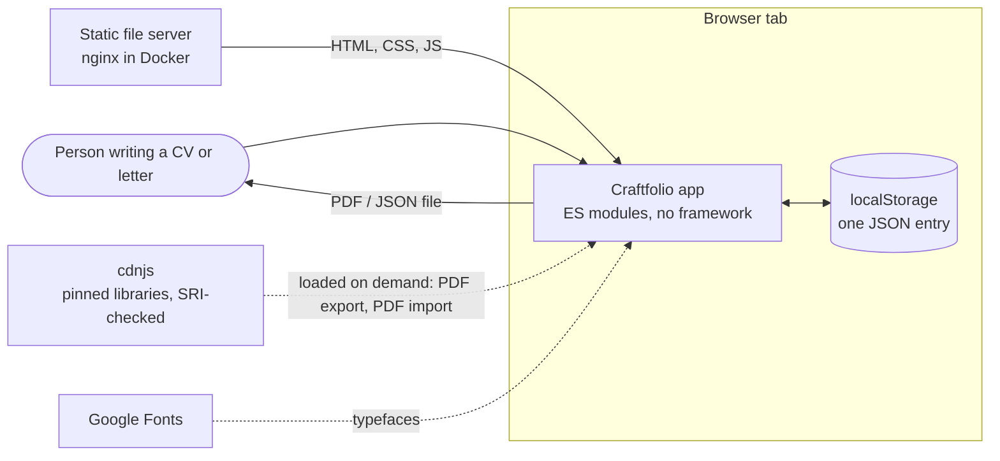
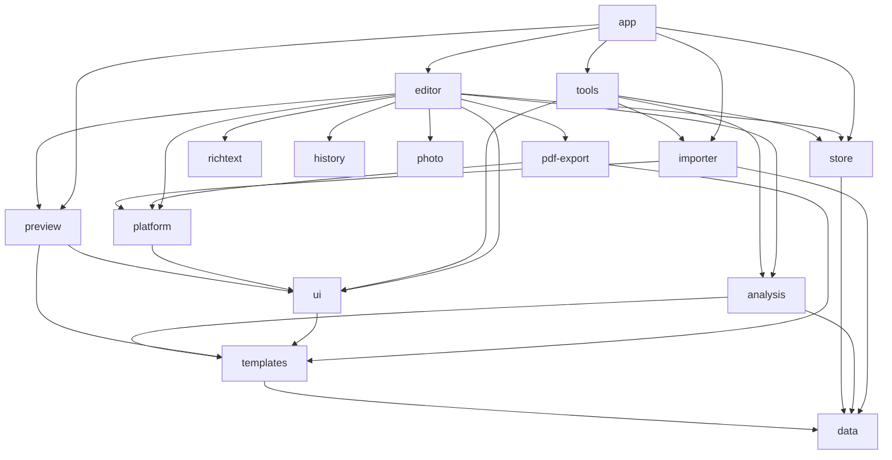

# Architecture

Craftfolio is a CV and cover letter builder that runs entirely in the browser. There is no backend: the server only hands out static files, and every document stays in the visitor's own browser.

Related documents: [data-flow.md](data-flow.md), [concurrency.md](concurrency.md), [design-rationale.md](design-rationale.md), [assumptions.md](assumptions.md), [testing.md](testing.md), [load-test.md](load-test.md).

## System context

Nothing a person types is sent anywhere. The only network traffic is downloading the app itself, the typefaces, and (the first time they are needed) the PDF libraries.

## Where it runs

The same files run in three places. Only `js/platform.js` knows the difference.

| Host | Entry page | Notes |
|---|---|---|
| Docker (`docker compose up`) | `index.html` | nginx 1.27, non-root, read-only filesystem, CSP. Port 8090. This is the production shape. |
| Any static server (`npm run serve`, `python -m http.server`) | `index.html` | Development and the browser tests. |
| Hosted Claude artifact | `artifact.html` | Same markup without the document skeleton (the host adds it). Print, `confirm()` and plain downloads are blocked there, so the app uses in-page dialogs and the host's download permission. |

## Module layers

Each module has one job. Imports only point downwards in this table; a unit test fails the build on a circular import or on a lower layer importing a view.

| Layer | Module | Responsibility | Touches the DOM |
|---|---|---|---|
| Views | `app.js` | Hash router; home, templates and documents views; app-wide actions (new, import, delete) | yes |
| | `editor.js` | Editor: form, live preview, coach panel, in-page editing, download | yes |
| | `tools.js` | ATS checker and job matcher views | yes |
| | `preview.js` | Scales A4 pages to fit their container | yes |
| Services | `pdf-export.js` | Builds a PDF from a document | yes (off-screen render) |
| | `importer.js` | Reads PDF/TXT files; turns résumé text into a structured CV | no (pdf.js only) |
| | `richtext.js` | Converts pasted HTML and the in-page editor's DOM to letter markup; bold/heading toggles | yes |
| | `platform.js` | Loads CDN libraries (pinned + integrity hash); saves files; detects the host | yes |
| | `photo.js` | Crops an uploaded image to a square and shrinks it to a 320 px JPEG | yes (canvas) |
| | `ui.js` | Query helpers, toast, confirm and file-name dialogs, path get/set | yes |
| Core | `store.js` | Persistence, cross-tab merge, change notifications | storage only |
| | `history.js` | Undo/redo: a list of snapshots with a cursor (pure) | no |
| | `analysis.js` | Coach, ATS check, keyword matcher (pure functions) | no |
| | `templates.js` | Renders a document to an HTML string; escaping | no |
| | `data.js` | Document shapes, defaults, validation (`normalizeDoc`), samples | no |

The core layer is plain JavaScript with no browser APIs, which is why the 118 unit tests run in Node without a browser or any test library.

The views also import `data`, `templates` and `ui` directly; those arrows are left out to keep the diagram readable. `richtext.js`, `history.js` and `photo.js` import nothing.

## Key components

### Documents (`data.js`)
Two document types share a base (`id`, `type`, `title`, `updatedAt`, `templateId`, `theme`, `personal`). `theme` holds the colour, font, content spacing step, page margin step and page size (`a4` or `letter`). `personal` holds the contact details and an optional `photo` (an embedded JPEG, PNG or WebP). On top of the base:

- **CV** adds `summary`, `experience[]`, `education[]`, `skills`, `projects[]`, `certifications`, `languages`, `achievements[]`, `interests`. A certification or language is one line of text, optionally `Name | detail | date`; language level dots are derived from the detail ("Fluent", "B2") when it is drawn, not stored.
- **Cover letter** adds `recipient`, `job`, `date`, `greeting`, `body`, `closing`.

All values are strings. The letter body uses a small markup: a blank line starts a paragraph, a line starting with `# ` is a bold sub-heading, `**text**` is bold.

`normalizeDoc()` is the single gate for anything coming from outside (storage, an imported JSON file). It whitelists fields, forces values to strings, caps lengths (300 characters for short fields, 5,000 for long ones, 20,000 for a letter body, 50 items per list), and replaces an unknown template, colour, font, spacing step, margin step or page size with the default, and drops a photo that is not a small embedded image.

### Rendering (`templates.js`)
A document is rendered to an HTML string for a page of fixed size: A4 (794 × 1123 CSS pixels) or US Letter (816 × 1056). The same function produces the live preview, the thumbnails and the page captured for PDF. Every value goes through `esc()`; nothing is inserted as raw HTML.

The 14 templates are rows in one table (`TEMPLATES`). Each row names a layout (`single`, `side-left`, `side-right`, `profile`), a header style, a skills style and, for the profile layout, whether education sits in the right column; the renderer branches on those, never on a template's id. They share one stylesheet (`css/templates.css`) and differ by a class on the page. Page size, spacing and margins reach the stylesheet as CSS variables (`--pw`, `--ph`, `--sp`, `--mg`) computed from validated steps, so no stored value is written into a style.

### Storage (`store.js`)
One `localStorage` entry holds `{ schema, docs, deleted }`. Every save is read–merge–write so that two open tabs do not overwrite each other. Details are in [concurrency.md](concurrency.md).

### Editor (`editor.js`)
The form and the page preview edit the same in-memory object. Typing in the form re-renders the page. Typing on the page (the letter body and four single-line fields are editable in place) updates the object and the form, but does not re-render the page until focus leaves it, so the caret never jumps.

The toolbar has Layout, Fonts and Themes menus (native `
` elements) and undo/redo. Undo keeps up to 100 snapshots of the document as JSON (`history.js`). Typing is recorded after a half-second pause so one step is a phrase; other changes are recorded at once. History lives in memory for the open editor only.

### PDF export (`pdf-export.js`)
Render the document off-screen → capture it as a bitmap → encode each page as an indexed-colour PNG → place invisible, word-positioned text on top. The result looks identical to the preview, the text can be selected and parsed, and a full one-page letter is about 160 KB. The reasoning and measurements are in [design-rationale.md](design-rationale.md).

## Security model

There is no server-side state and no authentication, so the attack surface is the page itself.

| Threat | Mitigation |
|---|---|
| Script injection through document fields | All output escaped by `esc()`; unit tests inject markup into every field of every template; browser tests confirm nothing runs |
| Hostile imported file | `normalizeDoc()` whitelists and coerces; template id, colour, font, page size and layout steps are checked against allow-lists; an import never replaces an existing document |
| Photo used to load or run something | A photo must be an embedded JPEG, PNG or WebP (`data:image/…;base64`) under 400,000 characters; web addresses and SVG are refused in `normalizeDoc()` and again when rendering. Uploads are re-encoded through a canvas, which also strips metadata such as GPS position |
| Tampered CDN file | Exact versions and Subresource Integrity hashes in `platform.js`; a unit test checks every library has both |
| Injected script from elsewhere | Content-Security-Policy in nginx: scripts only from the site and cdnjs, no inline scripts, no `eval` |
| Prototype pollution through form paths | `setPath`/`getPath` refuse `__proto__`, `prototype`, `constructor` |
| Container compromise | nginx runs as uid 101, filesystem is read-only, all Linux capabilities dropped, `no-new-privileges` |
| Personal details leaking into git | `js/profile.local.js` is git-ignored; CI asserts a CI-built image does not contain it |

Not covered: a browser extension or another script running on the same origin can read `localStorage`. That is true of any client-side storage.

## Known weaknesses

These are deliberate trade-offs or open items, listed so a reviewer does not have to find them.

1. **A long CV is cut into pages wherever the page height falls**, which can split a line or a card between two pages; there are no page-break rules and no page numbers.
1. **The PDF is an image with a text layer, not vector text.** Zooming far in shows pixels (192 dpi). See design-rationale.md for why.
2. **PDF export and PDF import need the CDN.** Offline, the editor works but those two features report that the library could not be loaded.
3. **Whole-document last-write-wins.** Two tabs editing the *same* document at the same time: the later save wins; fields are not merged.
4. **The documents view renders a real preview per document.** Fine for tens of documents; hundreds would be slow to draw.
5. **`index.html` and `artifact.html` are two copies of the same markup.** A unit test keeps them identical.
6. **The coach, ATS check and matcher are rules, not a language model.** They are predictable and offline, but shallow.
7. **A photo is stored inside the document** (about 30 KB as text), so it is repeated in every document and every undo snapshot that has one. Fine for tens of documents.
8. **A document with a photo uses a 256-colour page image** instead of 48, so the photo has no visible bands. Such a PDF is somewhat larger (123 KB for the sample CV with a photo).
9. **The photo is cropped to its centre square**; there is no manual crop.
10. **`contenteditable="plaintext-only"`** (single-line fields on the page) needs Chrome/Edge/Safari or Firefox 136+. In older Firefox those four fields are still editable from the form.
