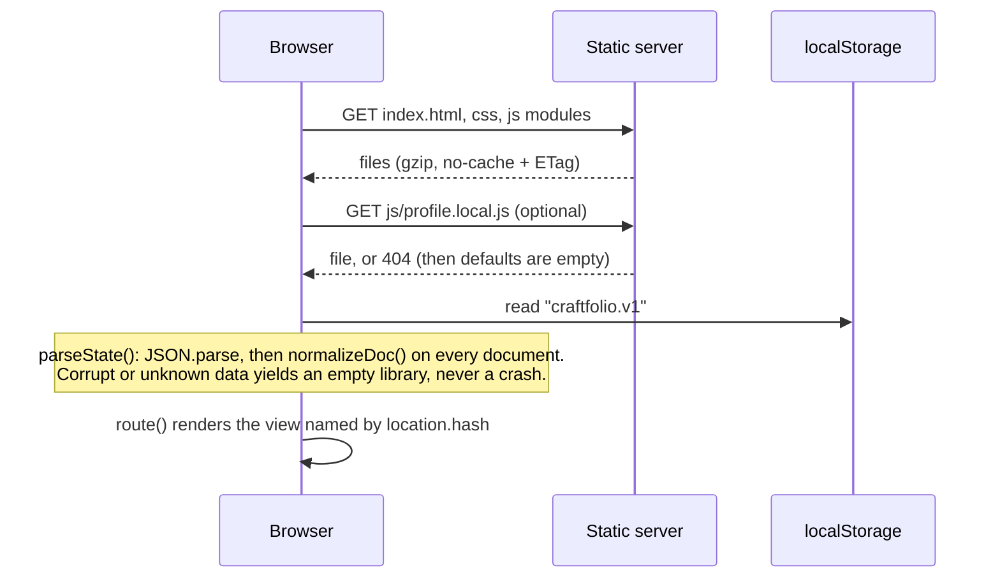
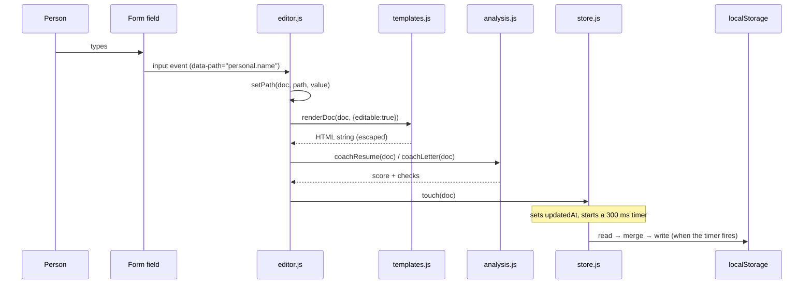
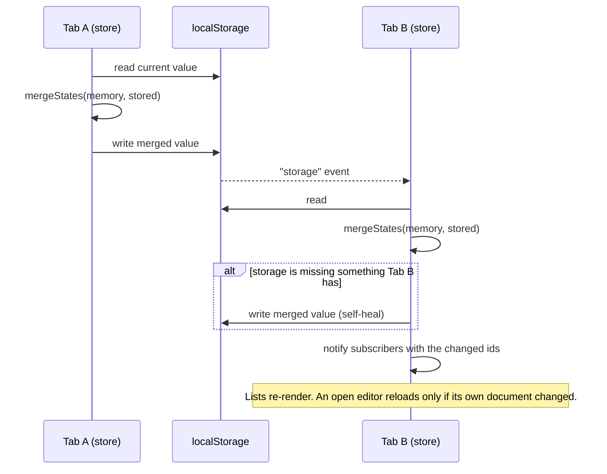
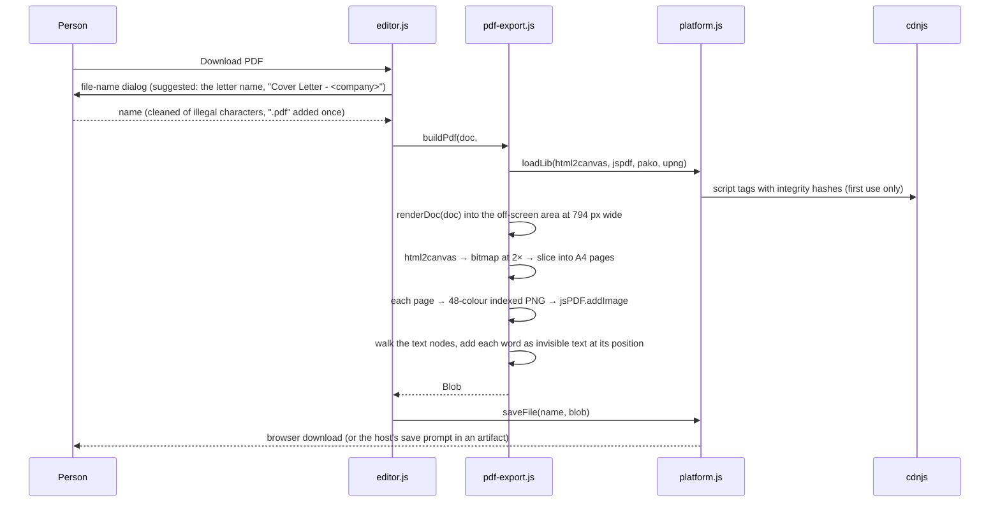

# Data flow

How data moves through Craftfolio, from a keystroke to storage, to another tab, and out as a PDF. Module names refer to the table in [architecture.md](architecture.md).

## Where data lives

| Data | Location | Lifetime |
|---|---|---|
| Documents | `localStorage["craftfolio.v1"]` as `{ schema: 2, docs: [...], deleted: { id: timestamp } }` | Until the person deletes them or clears site data |
| Working copy | `store` in memory (one per tab) | The tab's lifetime |
| Default personal details | `js/profile.local.js` (optional, git-ignored, read once at start-up) | Static file |
| Template filter, last-used editor | Module variables | The tab's lifetime |
| PDF, JSON export | Generated on demand, handed to the browser's download | Not kept by the app |

Nothing is stored on the server and nothing is sent to it.

## Start-up

Routing is by plain hash (`#documents`, `#templates-cover`, `#edit-<id>`, `#match-<id>`). Every real URL path is a file, so the server needs no rewrite rules.

## Editing in the form

One input event does all of this synchronously; rendering and coaching together take well under a millisecond (see [load-test.md](load-test.md)), so there is no need for a virtual DOM or partial updates.

## Editing on the page

The letter body and four single-line fields (recipient name, date, greeting, closing) are editable in the preview itself.

1. The browser changes the DOM inside the editable element.
2. `editor.js` converts that DOM back to the stored form: `editableToLetterText()` for the body (paragraphs, `# ` headings, `**bold**`), plain text for single-line fields.
3. The document object and the matching form field are updated; the coach and the page size are refreshed; `store.touch()` schedules the save.
4. The page is **not** re-rendered while it has focus, so the caret stays where it is. When focus leaves, the page is rendered from the stored text, which shows exactly what will be exported.

Changing the recipient name also updates the greeting (`Dear Mr. Brandt,`), unless the greeting was edited by hand.

## Pasting

| Paste target | Clipboard has HTML with bold/headings | Otherwise |
|---|---|---|
| Body text box | Converted to markup by `htmlToLetterText()`: bold runs → `**…**`, a short fully-bold line or an HTML heading → `# …` | Browser's normal plain-text paste |
| Body on the page | Converted the same way, then inserted as clean `
`/`<h4>`/`<strong>`; the source's fonts and colours are dropped | Plain text, paragraphs kept |

## Saving and other tabs

The merge rules are in [concurrency.md](concurrency.md).

## Importing

| Source | Path |
|---|---|
| JSON export | `JSON.parse` → `normalizeDoc()` → new id → `store.add()` |
| PDF | pdf.js (from the CDN, main thread) gives positioned text runs and font names → `itemsToText()` rebuilds reading order → `parseResumeText()` → `store.add()` |
| TXT | `file.text()` → `parseResumeText()` → `store.add()` |

Files are read in the browser; they are never uploaded.

**Reading order (`itemsToText`).** pdf.js returns runs of text with a position, a size and a font, in drawing order, which is not reading order. The runs are grouped into lines by baseline. Everything above the first section heading is the page header and is read as one block. Below it, the page is checked for a column gutter: an empty vertical band that almost no line crosses, with lines of their own on both sides. Right-aligned dates are not a column (they share baselines with the job title, or sit just left of the real gutter), and a narrow column of section titles is a side-heading layout, read as one column. With a gutter, the main column is read before the side column. Runs in a bold font become `**bold**`, a wide gap inside a line becomes a tab, and a gap between lines larger than the usual spacing becomes a blank line.

**Fields (`parseResumeText`).** The text is cut into sections at recognised headings. In the header, each part is classed as a contact detail (email, phone, web address, bare profile handle, "City, Country") or text; the first text that reads like a name is the name, the next short line the headline, the rest the summary. Jobs are anchored on their date lines: the lines above are the title, employer and a company note, or, when the title shares the date's line, the line below is "Employer<TAB>Place". Bullets are split at markers, else at blank lines, else at sentence ends. Certificates, languages and achievements are split at their date lines or bold titles.

Parsing is best-effort and the app says so after an import. A PDF exported by the app writes an invisible "- " before each list item, so a re-import (or a copy of the text) keeps the bullets apart.

## Exporting a PDF

The JSON export (`Export JSON`) is `JSON.stringify(doc)` handed to the same `saveFile()`.

## Tools

The ATS checker and job matcher work on plain text. A saved CV is first flattened by `resumeToText()`; pasted text and uploaded files are used as they are. Both tools are pure functions in `analysis.js`: text in, score and lists out. "Rebuild this CV" passes the text to `parseResumeText()` and opens the result in the editor.
